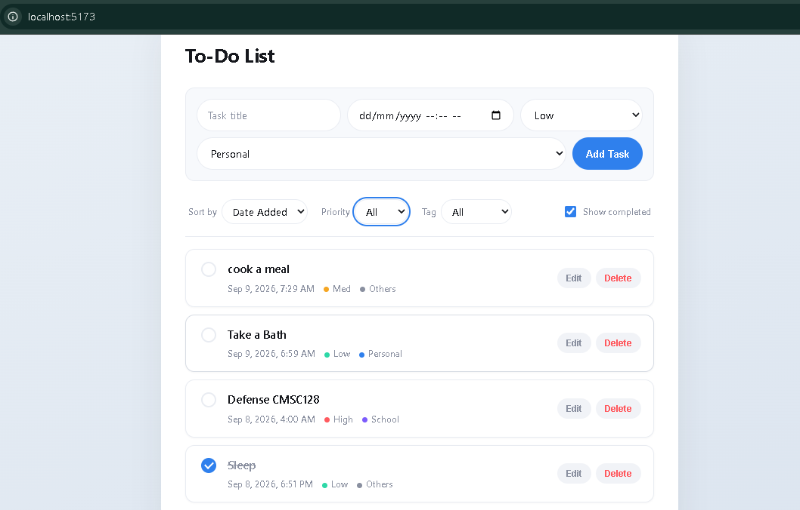
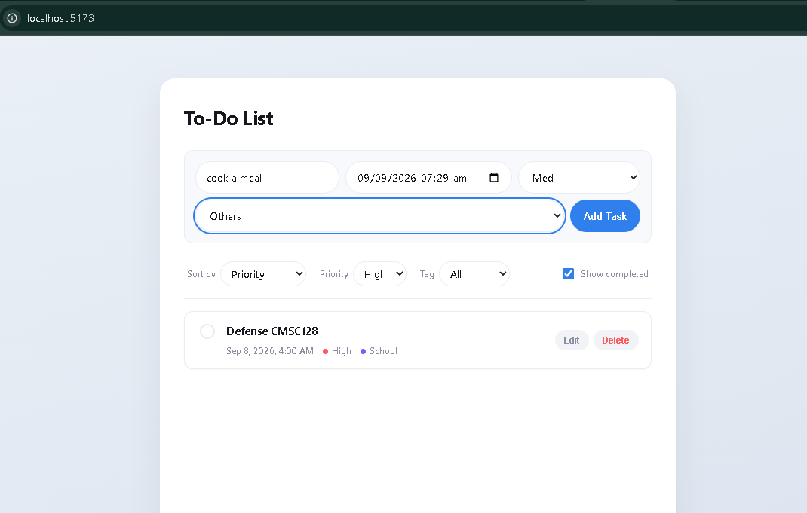
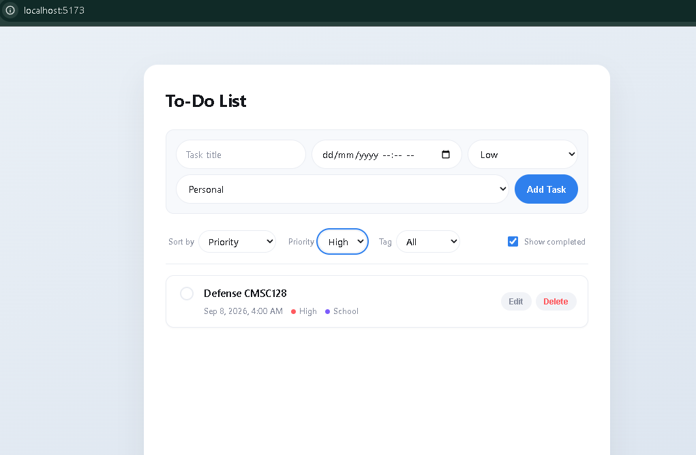
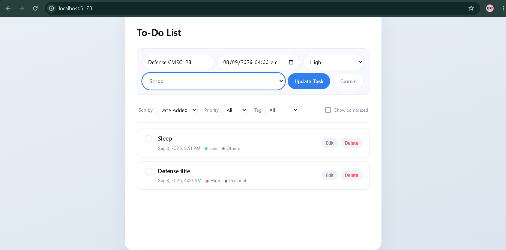
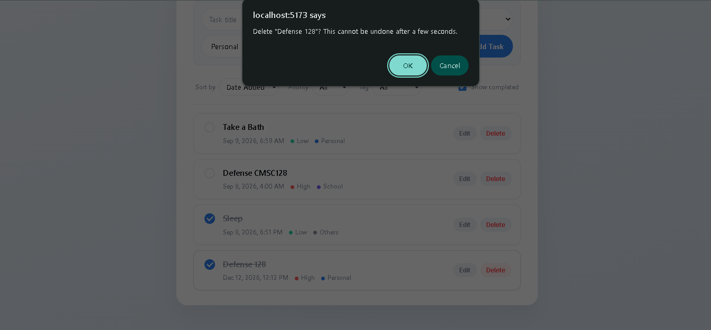
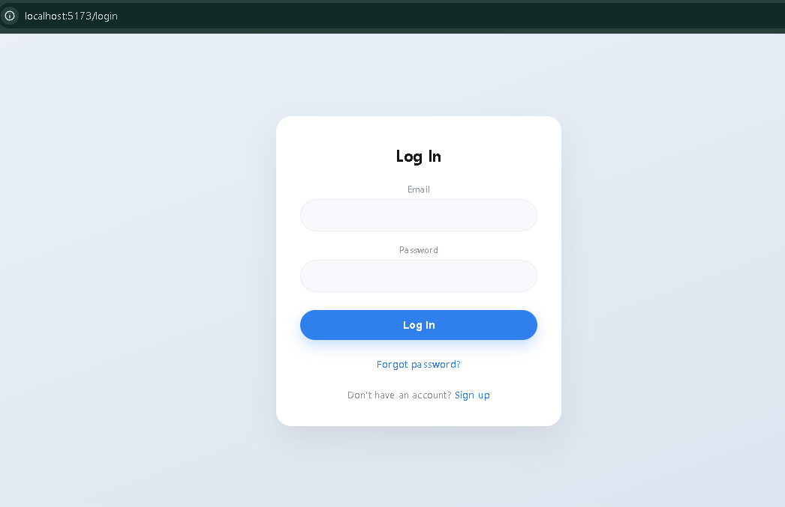
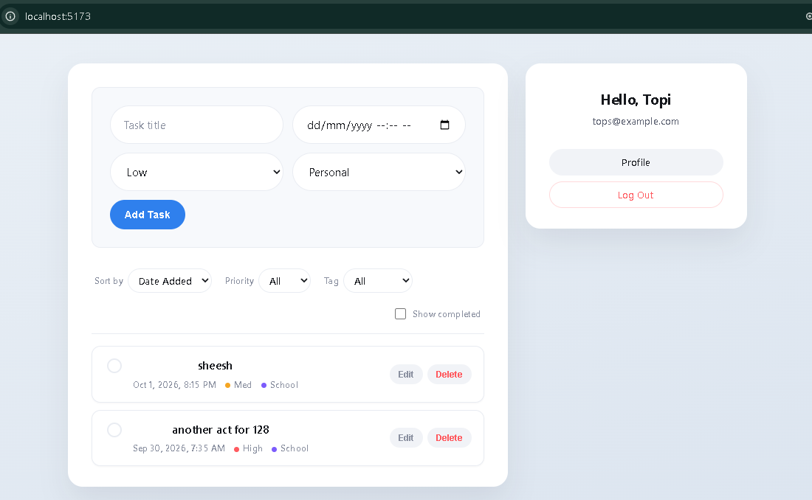

<p align="center"> 
    
    
     
     
     
</p>
    <h1 align="center"> ToDo List App</h1>
    <p align="center"><strong>Full Stack CRUD Application</strong></p> 
    <p align="center"> 
    <a href="#why-this-stack">Tech Stack</a> |
    <a href="#quick-start">Quick Start</a> |
    <a href="#api-endpoints">API Endpoints</a> |
    <a href="#screenshots">Screenshots</a>
</p>

### Why This Stack?

| Technology | Purpose | Benefits |
|------------|---------|----------|
| **FastAPI** | Backend Framework | Fast performance<br> Auto-generated OpenAPI docs<br> Async support |
| **Supabase** | Database | Managed PostgreSQL database accessed by the FastAPI backend |
| **Application authentication** | Accounts & sessions | FastAPI routes, bcrypt password hashes, and application-issued JWTs; task ownership is enforced by backend queries |
| **React** | Frontend UI | Component reusability<br> Virtual DOM<br> Rich ecosystem |
| **React Router** | Client Routing | Protected routes<br> Nested layouts<br> SPA navigation |

---

##  Quick Start

### Prerequisites

Before you begin, ensure you have installed:

- [Python 3.8+](https://www.python.org/downloads/) - For running FastAPI backend
- [Node.js 16+](https://nodejs.org/) - For running React frontend
- [npm](https://www.npmjs.com/) - Package managers
- [Git](https://git-scm.com/downloads) - For cloning the repository

---
### Configuration & Setup

### Step 1: Clone the Repository


`git clone https://github.com/TUP-e/cmsc128-Lab1_CRUD_Nice` </br>
`cd cmsc128-Lab1_CRUD_Nice`


### Step 2: Backend Setup (FastAPI)
at the repo root execute 
`cd backend`

|OS|Command|
|-----|-----|
| Windows | `python -m venv venv` </br> `venv\Scripts\activate`|
| Mac/Linux | `python3 -m venv venv` </br> `source venv/bin/activate`|

Also install the python dependencies with `pip install -r requirements.txt`


Create a .env file in the backend/ folder: </br>
`SUPABASE_URL=https://your-project-id.supabase.co` </br>
`SUPABASE_KEY=your-public-anon-key` </br>
`JWT_SECRET=your-jwt-secret`

Optional: </br>
`FRONTEND_URL=http://localhost:5173` </br>
`DEMO_MODE=true`


### Step 3: Frontend Setup (React + Vite)
at the repo root execute </br>
`cd frontend` or `cd ../frontend` from the previous step


Create a .env file in the frontend/ folder: </br>
`VITE_API_URL=http://localhost:8000`

then install node dependencies `npm install`

### Local Ports
`http://localhost:8000` - FastAPI server </br>
`http://localhost:8000/docs` - Swagger UI Documentation and Testing </br>
`http://localhost:8000/tasks/` - Authenticated task endpoint (requires a bearer token) </br>
`http://localhost:5173` - Frontend UI renders React App

Note: Your frontend port may vary (5173, 5174, etc.). Check the terminal output after running npm run dev.

## Startup Commands
for running backend server : </br>
(run inside backend\ directory)
`source venv/Scripts/activate`
`uvicorn app.main:app --reload --port 8000` </br>
for running the frontend UI : </br>
(run inside frontend\ directory)
`npm run dev` requires a running backend


## Features

### Authentication
- Register with email and password
- Login with email and password
- Forgot password / reset password demo flow (no email service is configured)
- Protected routes redirect unauthenticated users to `/login`
- Session persisted with a JWT stored client-side

> Note: The reset link is printed in the backend terminal. With `DEMO_MODE=true`, it is also returned in the API response for local testing.

### Task Management
- Create tasks with title, due date, priority, and tag
- Edit existing tasks inline
- Mark tasks as done / undone
- Soft delete tasks with a 5-second undo toast
- Sort by created date, due date, priority, or tag
- Filter by priority, tag, and completion status

### Task ownership and access control
- Each task has a `user_id` foreign key to `public.users.id`.
- The backend derives the owner from the validated bearer token when creating a task; it does not trust an owner ID from the request body.
- Every task endpoint requires authentication. List queries filter by the current user's ID, and single-task reads, updates, deletes, and restores filter by both task ID and owner ID. A task owned by another user returns 404.

### Activity 3 integration and schema
- The `act3-ubac` branch continues from the working `act2-accounts` codebase, where the CRUD and account features were already present together. The ownership work integrates them by using the authenticated account ID in the task API.
- The checked-in history has no separate merge commit or recorded conflicts; the features were already present together when the Activity 3 ownership work began.
- `users` stores account records. `tasks.user_id` references `users.id`, so each task has one owner without copying account details into the task record.
- Add the ownership column in the Supabase SQL Editor (this assumes `public.users.id` is UUID):

  ```sql
  alter table public.tasks
  add column if not exists user_id uuid references public.users(id) on delete cascade;
  ```

- Existing tasks need an owner assigned before they appear in a user's task list. Assign each task to its rightful user, or delete and recreate the demo tasks while signed in as their intended owners.
- Task creation uses the user ID resolved from the app's signed JWT. List, get, update, delete, and restore operations are scoped by that user ID in `backend/app/routes/tasks.py`.
- For a single-task read, the backend applies both filters before returning data: `eq("id", task_id).eq("user_id", current_user["id"])`. An ID from another account therefore matches no row and returns 404.


### Profile
- Update display name and email
- Change password (requires current password)
- View current account info in a dedicated `/profile` page

### Home Layout
- Two-column layout: task list on the left, user sidebar on the right
- Sidebar shows display name, email, and quick links to Profile / Log Out
- Responsive: stacks into a single column on narrow screens


## API Endpoints
### REST API Reference

| Method | Endpoint | Description |
|--------|----------|-------------|
| `POST` | `/auth/register` | Register a new user |
| `POST` | `/auth/login` | Log in and receive a JWT |
| `GET` | `/auth/me` | Get the current user from a bearer token |
| `PUT` | `/auth/profile` | Update the current user's profile |
| `PUT` | `/auth/password` | Change the current user's password |
| `POST` | `/auth/forgot-password` | Generate a reset link (demo flow; no email is sent) |
| `POST` | `/auth/reset-password` | Reset password with token |
| `GET` | `/tasks/` | Get the authenticated user's active tasks |
| `GET` | `/tasks/{id}` | Get a task only if owned by the authenticated user |
| `POST` | `/tasks/` | Create a task owned by the authenticated user |
| `PUT` | `/tasks/{id}` | Update a task only if owned by the authenticated user |
| `DELETE` | `/tasks/{id}` | Soft delete a task only if owned by the authenticated user |
| `POST` | `/tasks/{id}/restore` | Restore a task only if owned by the authenticated user |


### Example API Calls
#### Create a Task

```
Request:
POST /tasks
Authorization: Bearer <jwt>
Content-Type: application/json

{
  "title": "Study CMSC 128",
  "due_date": "2026-09-07T20:00:00",
  "priority": "High",
  "tag": "School"
}
```

The backend validates the bearer token, resolves its user ID, and sets that ID as `user_id` itself.

```
Response:
{
  "id": "550e8400-e29b-41d4-a716-446655440000",
  "user_id": "f4c8be9e-97dc-42ba-949b-404d35c4a14f",
  "title": "Study CMSC 128",
  "due_date": "2026-09-07T20:00:00",
  "priority": "High",
  "tag": "School",
  "is_done": false,
  "created_at": "2026-09-07T12:00:00",
  "deleted_at": null
}
```
### Screenshots
| App Overview |
|--------------|
||
||
||
||
||
||
||
||
||
